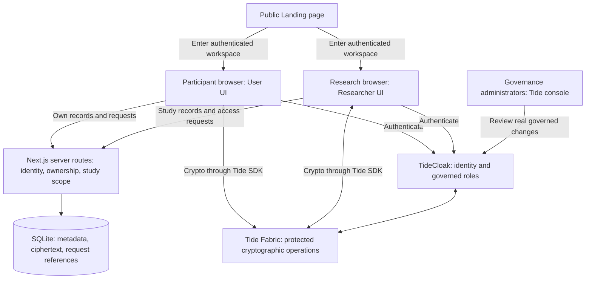
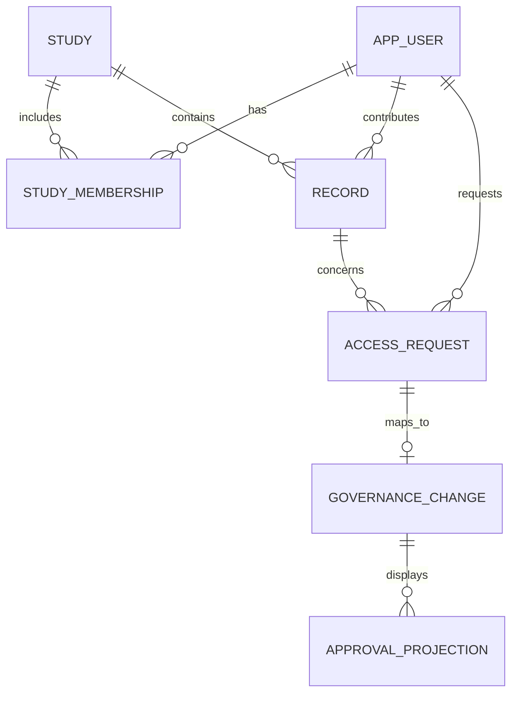
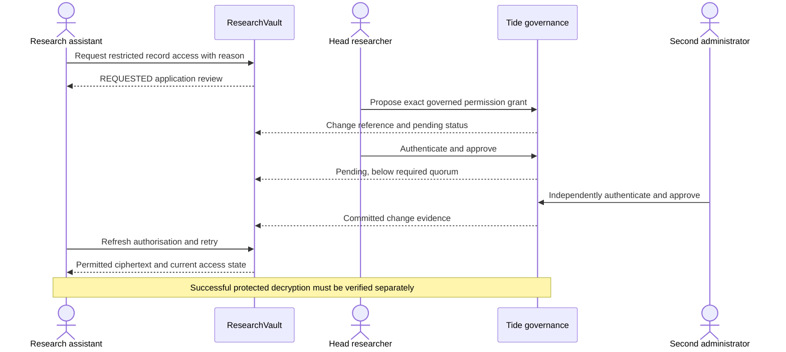

# System architecture

Status: proposed architecture. This repository contains no running components. The [API contract](06-API-AND-DATA-CONTRACT.md) is the frontend/backend handshake; [integration gates](04-TECHSTACK-AND-TIDE-INTEGRATION.md) determine whether the protected sharing design is usable.

## Component view



The diagram is logical; it does not prescribe undocumented Tide network calls. Use the supported SDK and current integration playbook. Tide MCP belongs to development, outside this runtime diagram.

## Responsibilities and authority

| Component | Owns | Must not become authoritative for |
|---|---|---|
| Browser/UI | Rendering, input, encryption/decryption integration, user interaction | Arbitrary role claims or self-granted access |
| Next.js server | Verified session identity, ownership checks, study scope, metadata API, integration adapter | Fabric approval results it has not verified |
| SQLite | App entities, encrypted payloads, opaque governance references, display projections | A substitute for Tide-governed roles or committed policy |
| TideCloak/QEA | Governed identity/permission changes and their lifecycle | Application ownership rules that were never modelled |
| Tide crypto/Fabric | The protected operation supported by the selected integration | Plaintext already copied to an authorised endpoint |
| Tide console | Authentic approval UI for the MVP | A fake app-only approval counter |

Protected routes must verify tokens and authorise each requested resource. Hiding a button is a usability measure, not enforcement. Browser requests must not carry a trusted `userId`, `role`, `clearance`, or approval count chosen by the caller.

## Permission model

Conceptually:

```text
Permit read when:
  authenticated identity
  AND ownership or explicit study/resource entitlement
  AND permitted data category/action
  AND relevant protected cryptographic authorisation succeeds
```

This is a proposed policy, not executable code. The backend checks ownership and study membership. For a strong Tide demonstration, the cryptographic access configuration must also represent the intended resource/category scope; an app check alone must not be described as Fabric enforcement.

Participant sharing scope is an additional requirement if consent controls are implemented. A mutable consent checkbox in SQLite does not establish cryptographic enforcement of that scope.

Proposed application capability names include `record:read:restricted` and `governance:propose`. They are not official Tide API role names. The backend owner maps them to documented, committed Tide configuration.

## Data boundaries

Separate three payloads rather than storing one all-access JSON document:

- **Internal protocol:** nonsensitive study instructions.
- **Restricted response:** coded interview content; still sensitive.
- **Highly restricted identity:** the mapping between participant identity and coded record.

Give separately protected payloads distinct category/policy bindings. Verify that access to a response does not implicitly decrypt its identity mapping.

Store opaque participant references in ordinary metadata. Identifying names, free-text responses, detailed request reasons, and record titles may be sensitive too. Use synthetic examples and keep logs free of tokens, keys, raw payloads, and unneeded identifiers. The demo database is not a place for actual participant data.

### Proposed entity relationships



Approval projections are cached evidence for display, never independent signatures. Tide owns the actual governed change. An application activity log and Tide's governance log have different coverage; label their sources.

## Read workflow

1. User authenticates through TideCloak.
2. Browser requests permitted record metadata/ciphertext through the app API.
3. Server verifies identity, record ownership or study entitlement, and relevant scope. It does not trust URL parameters as proof of ownership.
4. Browser invokes the supported Tide operation for the selected encrypted payload.
5. Show plaintext only after successful decryption in the intended account/session.
6. If API denies, crypto denies, session expires, or Tide is unavailable, preserve the corresponding error. Never render a cached success as current authorisation.
7. On logout or account/session change, clear displayed plaintext and invalidate old record/query caches.

Do not send plaintext to Next.js for server-side decryption and then claim the backend never sees it. If the implemented design requires a trusted plaintext processor, document that changed boundary before recording.

## Governed grant workflow



The native console may be the actual proposal/approval surface. A custom UI is optional. Do not implement a generic privileged proxy that signs all approvals using one service credential.

### State model

```text
REQUESTED → PENDING_GOVERNANCE → COMMITTED → ACTIVE
         ↘ REJECTED          ↘ FAILED
```

- REQUESTED: app review only; no new entitlement.
- PENDING_GOVERNANCE: correlated Tide change exists; approval threshold not yet committed.
- COMMITTED: authentic governed change is committed; session/crypto verification may still be pending.
- ACTIVE: current user authorisation reflects the grant and protected read has succeeded.
- REJECTED/FAILED: no new access; display a reason appropriate for the user.

This is the app's proposed projection, not Tide's native status enumeration. A pending request must not become ACTIVE because a frontend timer elapsed.

## Governance configuration and limits

Use three governed administrators to demonstrate the documented two-approval threshold. It is **any qualifying two of the three** under the standard configuration, not an automatic guarantee that a specific ethics role is mandatory. A mandatory ethics approver would require a separately verified policy. [QEA documentation](https://docs.tide.org/Core-Concepts/iga-workflow)

The backend owner must inspect the `master` realm, initial bootstrap state, administrator membership changes, offboarding, and deployed crypto policy before making broad administrator-resistance claims. The demo proves a defined workflow, not every privileged administrative path.

## Integration seams and fallback

Frontend consumes the shared view model, a clearly labelled fixture adapter during layout work, and a live adapter during the integrated demo. Switching adapters never creates real permissions.

If custom approval integration is too costly, link to the native Tide console and resynchronise its actual result. If shared decryption fails, stop claiming integrated sharing; keep the UI labelled simulated and demonstrate only the governance behavior that actually works. Do not fall back to server-held universal decryption keys under an unchanged E2EE claim.
