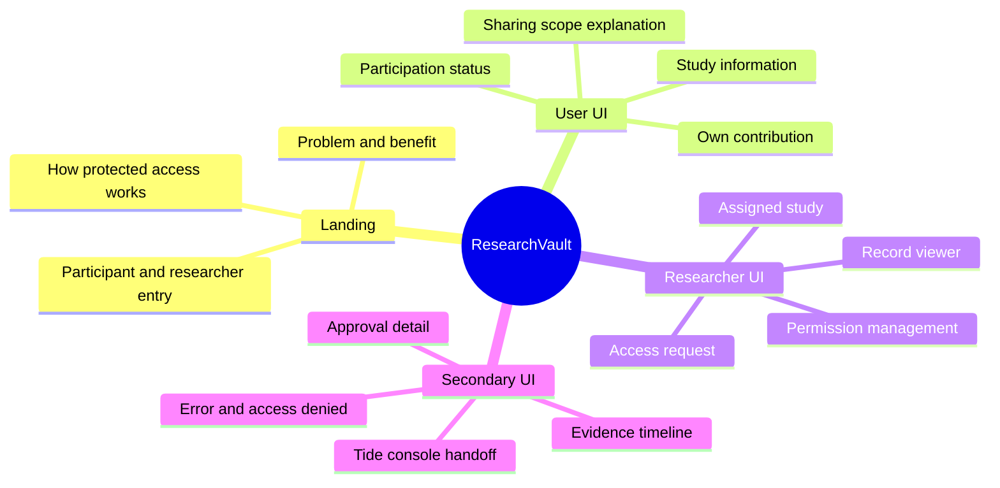

# Feature map and permission matrix

Status: proposed implementation scope. **P0** is the required product slice for the intended demo; **P1** is optional after the integration works; **Later** is outside the hackathon baseline. Ownership follows the [proposal](01-PROPOSAL.md).

## Feature tree

## Features and acceptance evidence

| ID | Feature | Priority | Frontend responsibility | Backend/logic responsibility | Observable acceptance |
|---|---|---|---|---|---|
| F01 | Landing page | P0 | Explain product, audience entries, synthetic-demo label | Public route | Both entry paths lead to real sign-in or labelled preview |
| F02 | Authentication/session | P0 | Session state, sign-in/out, expiry UI | Tide integration and verified identity | Different accounts have different entitlements |
| F03 | Participant study view | P0 | Study purpose, contribution summary, sharing explanation | Own-data filtering | Participant cannot fetch another participant's record |
| F04 | Participant own-record viewer | P0 | Protected content states | Seed owned encrypted record; owner decryption | Own synthetic content opens with correct session |
| F05 | Researcher study dashboard | P0 | Assigned work and metadata | Study membership and filtered listing | No unrelated participant identifiers in list |
| F06 | Three data categories | P0 | Text labels and accessible status icons | Distinct payloads and verified policy mapping | Restricted grant does not open identity payload |
| F07 | Protected record read | P0 | Render only after permitted decrypt | Shared crypto path and API checks | Allowed account succeeds; disallowed account fails |
| F08 | Access request form | P0 | Scope/reason validation, submit state | Persist requester identity and requested resource | Duplicate submit does not create multiple grants |
| F09 | Head researcher proposes grant | P0 | Request review, pending state, native-console link | Exact governed change and correlation | App request links to authentic Tide change |
| F10 | Quorum approval | P0 | Display sourced count/status or console handoff | Three real administrators and committed-change verification | One approval insufficient; configured quorum commits |
| F11 | Refresh and retry | P0 | Refresh control, re-evaluate view | Current session/claims and successful crypto verification | COMMITTED does not imply ACTIVE prematurely |
| F12 | Evidence view | P0 | Source-labelled event timeline | Sanitised app events and authentic QEA references | No fabricated signing result or unsupported audit coverage |
| F13 | Fresh participant submission | P1 | Form and encryption progress | Verify cross-user sharing, persist ciphertext | Authorised researcher can open intended submission |
| F14 | Second-study scope test | P1 | Another study and denial state | Separate configured scope and fixtures | Higher rank alone does not grant another study |
| F15 | Withdrawal request | P1 | Request form and honest pending status | Define separate consent workflow | Never say access revoked until verified |
| F16 | Cryptographic consent/expiry/revocation | Later | Only after contract is defined | Policy enforcement, stale-session handling, verification | No claim of deleting previously copied plaintext |
| F17 | AI summarisation, exports, notifications | Later | Not in baseline screens | Separate data/authority design required | Not represented as live features |

## Role versus data entitlement

The following matrix describes application intent, not default Tide behavior. A data permission is explicit and study-scoped. Governance and data permissions are independent.

| Action | Participant | Assistant | Head researcher | Data steward | Ethics representative |
|---|---|---|---|---|---|
| Read public study description | Yes | Yes | Yes | Yes | Yes |
| View own contribution | Own only | If contributor, own only | If contributor, own only | If contributor, own only | If contributor, own only |
| Read internal study protocol | No by default | Assigned study | Assigned study | Assigned study if assigned | If explicitly assigned |
| Read restricted coded responses | Own only | Explicit grant | Explicit grant | Explicit grant | Explicit grant |
| Read identity mapping | Own only where applicable | No baseline grant | No automatic grant | Explicit grant | No automatic grant |
| Request research access | Not baseline | Yes | Yes | Yes | If study member |
| Propose governed permission change | No | No | Yes | Yes | Yes |
| Approve governed change | No | No | If governance admin | If governance admin | If governance admin |
| Change own clearance unilaterally | No | No | No under demonstrated governed path | No under demonstrated governed path | No under demonstrated governed path |

All three governance administrators can qualify toward the configured quorum. Enforcing a specific role's approval is a separate policy, not a feature implied by this matrix.

## UI and security state vocabulary

| State | What to show | What must not happen |
|---|---|---|
| Loading | Skeleton or progress | Briefly display prior account's plaintext |
| Unauthenticated | Sign-in | Fetch protected data as a demo persona |
| Locked | Category, safe explanation, request action | Render hidden plaintext in the DOM |
| REQUESTED | Request submitted; awaiting review | Increase effective clearance |
| PENDING_GOVERNANCE | Actual change reference and sourced progress | Fabricate signatures or increment count on click |
| COMMITTED | Permission committed; refresh/retry required | Treat commitment alone as successful decryption |
| ACTIVE | Successfully accessed permitted data | Open higher-category fields by inheritance |
| Rejected | Safe reason and next action | Reuse cached successful output |
| Provider unavailable | Retry or honest unavailable state | Call network failure a permission denial |
| Fixture preview | Persistent simulation label | Present prewritten approval states as real Tide evidence |

## First vertical slice

Build the minimum path through F02, F06, F07, F09, F10, and F11 before expanding dashboards. Coworkers can build F01/F03/F05 layouts in parallel against fixture states, but live implementation claims depend on the backend owner's integration evidence.

The participant's sharing explanation must distinguish existing configured access from proposed future consent controls. A switch that changes text only must never be labelled a live consent or revocation control.
